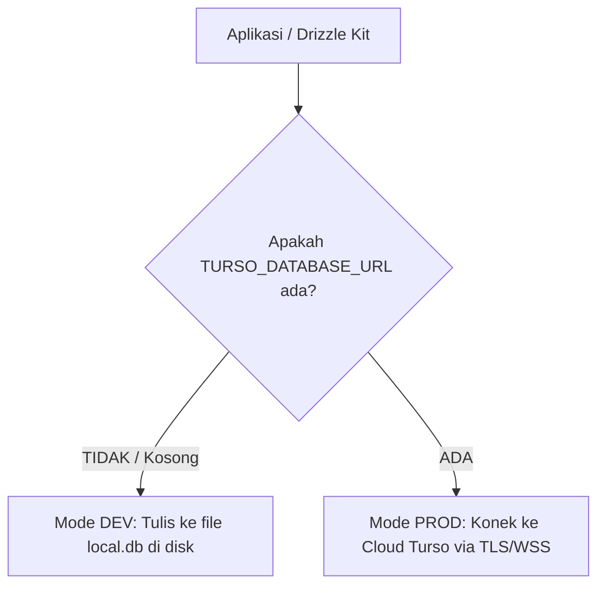

# 🗄️ Database Architecture & Migration Guide: Dev vs Prod
**Database Engine:** libSQL (SQLite compatible) by Turso  
**ORM & Tooling:** Drizzle ORM + Drizzle Kit  
**Konsep Utama:** *Zero-friction local development + Pure schema-only production deployment*

---

## 1. Menjawab Pertanyaan: "Tadi Masuk ke Mana Padahal Belum Bikin DB di Turso?"

Tadi saat menjalankan `drizzle-kit push` dan seeding, datanya **TIDAK** masuk ke cloud Turso, melainkan masuk ke file lokal di komputermu:
📍 **`d:\Projects\komik\local.db`**

### Kenapa Bisa Begitu?
Sistem dirancang dengan **Dual-Mode Fallback**:

Keuntungannya: Kamu bisa mengembangkan dan mengetes seluruh fitur ShrimpHub di laptop secara offline tanpa perlu repot mendaftar atau menyalakan koneksi Turso cloud terlebih dahulu.

---

## 2. Pemisahan Lingkungan: DEV vs PROD

| Aspek | 🛠️ Lingkungan Development (DEV) | 🚀 Lingkungan Production (PROD) |
| :--- | :--- | :--- |
| **Penyimpanan** | File lokal: `d:\Projects\komik\local.db` | Serverless Edge: Cloud Turso (`libsql://shrimphub-xxx.turso.io`) |
| **Internet** | 100% Offline | Butuh Internet (diakses Vercel Edge Functions) |
| **Isi Data** | Termasuk data dummy / testing (*mock* transaksi, komik sample) | **HANYA struktur tabel kosong**, siap diisi data pribadimu yang asli |
| **Kredensial** | Otomatis tanpa token | Membutuhkan `TURSO_DATABASE_URL` & `TURSO_AUTH_TOKEN` |

---

## 3. Alur Migrasi Schema (Hanya Struktur Tabel, Tanpa Data)

Drizzle Kit bekerja dengan membaca definisi TypeScript di `packages/database/src/schema.ts`.
Ketika kamu menjalankan perintah migrasi / push:
1. Drizzle Kit **hanya menganalisis struktur DDL SQL** (`CREATE TABLE`, `ALTER TABLE`, `ADD COLUMN`).
2. Script seeding (`seed.ts`) terpisah total dan **tidak pernah dijalankan otomatis** saat push schema ke production.

---

## 4. Panduan Perintah (NPM / PNPM Scripts)

### A. Untuk Development Lokal (Di Laptop)
Jalankan di root folder:
```bash
# 1. Update/sinkronkan struktur tabel ke local.db
pnpm db:push

# 2. (Opsional) Isi data dummy/testing untuk dicoba-coba
pnpm db:seed

# 3. Buka UI visual database di browser untuk melihat data
pnpm db:studio
```

---

### B. Untuk Production (Deploy ke Turso Cloud)

#### Langkah 1: Buat Database di Turso (Hanya 1x di Awal)
Kamu bisa gunakan website [turso.tech](https://turso.tech) atau Turso CLI:
```bash
# Buat database gratis bernama shrimphub
turso db create shrimphub

# Dapatkan URL Database (contoh: libsql://shrimphub-username.turso.io)
turso db show shrimphub --url

# Dapatkan Auth Token
turso db tokens create shrimphub
```

#### Langkah 2: Buat File Kredensial Production
Buat file bernama `.env.production` di root folder proyek:
```env
TURSO_DATABASE_URL=libsql://shrimphub-username.turso.io
TURSO_AUTH_TOKEN=eyJh...token_rahasiamu...
```
*(File `.env.production` sudah otomatis masuk `.gitignore` sehingga tidak akan bocor ke git).*

#### Langkah 3: Eksekusi Migrasi ke Cloud (Hanya Tabel Kosong)
Jalankan perintah ini:
```bash
pnpm db:push:prod
```
> [!IMPORTANT]
> Perintah `pnpm db:push:prod` ini **HANYA membuat tabel-tabel kosong di Turso Cloud**. 
> Data dummy di `local.db` milik laptopmu **TIDAK AKAN** masuk ke server Turso. Database production kamu akan bersih 100% siap dipakai mencatat data harian aslimu.

#### Langkah 4: Masukkan Kredensial ke Vercel
Saat deploy ke Vercel, cukup tambahkan 2 Environment Variables di Vercel Dashboard:
- `TURSO_DATABASE_URL`
- `TURSO_AUTH_TOKEN`
- `SHRIMPHUB_SECRET` (PIN / Master Password login pribadimu)

---

## 5. Cara Reset / Hapus Database Dev Kapan Saja
Jika data testing di local sudah terlalu berantakan dan ingin mulai dari nol di laptop:
Cukup hapus file `local.db`:
```powershell
Remove-Item local.db, local.db-journal -Force
pnpm db:push
pnpm db:seed
```
Selesai! Database lokal langsung ter-reset bersih dan terisi kembali.
