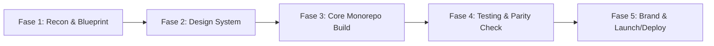

# 🚀 Master Execution Plan (Replica Workflow)
**Project:** NexusHub (Personal OS)  
**Methodology:** 11-Stage Replica Skill Pipeline & UI/UX Pro Max Intelligence  
**Documentation Artifacts Location:** `replica/` & `docs/`

---

## Ringkasan Tahapan Eksekusi

---

## Fase 1: Reverse-Engineering & Arsitektur Database

### Tahap 1: `/replica-recon` (Analisis Pola UX & Fitur Target)
- **Aktivitas:**
  - Bedah pola UX tercepat dari target:
    - **Lunch Money & Wallet:** Form modal cepat, categorizer, visualisasi burn-rate.
    - **Cal.com:** Struktur blok kalender, timezone handler, slot picker.
    - **Ray.so:** Config state editor kode, canvas screenshot generator.
    - **Tally.so:** Shortcut keyboard, floating block action.
    - **Kenmei/AniList:** Mekanisme counter chapter bacaan.
  - Inventarisir field data dan user journeys.
- **Artefak Output:**
  - `replica/recon.md` (Peta layar & alur pengguna)
  - `replica/features.csv` (Matriks fitur berbobot: *Must*, *Should*, *Could*)

### Tahap 2: `/replica-architect` (Desain Monorepo & Skema Turso)
- **Aktivitas:**
  - Setup struktur monorepo Turborepo (`apps/web`, `packages/database`, `packages/ui`).
  - Desain skema relational database via **Drizzle ORM** untuk **Turso**:
    - `users` & `sessions` (Autentikasi & proteksi)
    - `transactions` & `categories` & `wallets` (Keuangan)
    - `events` & `schedules` (Jadwal/Kalender)
    - `notes` & `tasks` (Catatan & Checklist)
    - `comics` & `reading_logs` (Tracker komik)
    - `snippets` (Koleksi kode/catatan indah)
  - Desain API routes / Server Actions pattern untuk *optimistic mutations*.
- **Artefak Output:**
  - `replica/architecture.md` (Dokumen blueprint teknis & arsitektur data)
  - `packages/database/src/schema/*.ts` (Skema Drizzle siap migrasi)

---

## Fase 2: Design System & Design Intelligence

### Tahap 3: `/replica-design` & `ui-ux-pro-max` (Design System & Tokens)
- **Aktivitas:**
  - Menjalankan search query token via tool `ui-ux-pro-max`:
    - Pemilihan palet warna: Deep Zinc/Slate dark base dengan aksen semantik (Emerald untuk uang masuk, Rose uang keluar, Violet untuk jadwal, Amber untuk komik).
    - Typography pairing: Geist / Inter (body) + JetBrains Mono (angka & kode snippet).
    - Grid & spacing: Skala kelipatan 4/8px.
  - Setup komponen dasar atomik di `packages/ui`:
    - `Button`, `Input`, `Dialog/Modal`, `DropdownMenu`, `Card`, `Badge`.
    - `CommandMenu` (KBar / CMDK primitive).
    - Custom micro-interaction animasi Spring (Framer Motion).
- **Artefak Output:**
  - `packages/ui/src/globals.css` (Variabel token warna, radius, font)
  - `replica/tokens.md` (Dokumentasi spesifikasi desain & rasio kontras WCAG)

---

## Fase 3: Pembangunan Aplikasi (Build & Backend)

### Tahap 4: `/replica-build` (Pembangunan Layar & Interaksi UI)
- **Aktivitas (Vertical Slice by Slice):**
  - **Slice 1 (Shell & Auth):**
    - Layar login minimalis beranimasi (PIN / Master Password).
    - App Shell (Sidebar lipat, Header status, Universal `Cmd+K` Trigger).
  - **Slice 2 (Bento Dashboard Hub):**
    - Grid modular menampilkan ringkasan semua modul secara sekilas.
  - **Slice 3 (Finance Tracker):**
    - Input modal cepat + parsing teks cerdas.
    - Tabel mutasi transaksi & grafik ringkasan bulanan.
  - **Slice 4 (Schedule & Planner):**
    - Kalender timeblock harian/mingguan.
  - **Slice 5 (Notes & Comic Tracker):**
    - Scratchpad cepat dan counter chapter komik `+1 click`.
  - **Slice 6 (Snippet Studio):**
    - Editor canvas dan tombol download gambar PNG.
- **Artefak Output:**
  - Kode aplikasi fungsional di `apps/web/src/app/*`.

### Tahap 5: `/replica-backend` (Koneksi Database, Auth, & Server Actions)
- **Aktivitas:**
  - Setup koneksi client Turso (`@libsql/client` + `drizzle-orm`).
  - Implementasi autentikasi session terenkripsi di Next.js Middleware.
  - Tulis Server Actions untuk seluruh operasi CRUD setiap modul.
  - Implementasi *Optimistic Updates* di sisi React state.
- **Artefak Output:**
  - `apps/web/src/middleware.ts`
  - `apps/web/src/actions/*.ts`
  - Migrasi database sukses di Turso.

---

## Fase 4: Pengujian & Quality Assurance

### Tahap 6: `/replica-test` (End-to-End & Bug Testing)
- **Aktivitas:**
  - Penyusunan skenario pengujian:
    1. Validasi proteksi login (unauthenticated user tidak bisa intip data).
    2. Kecepatan input transaksi & kalkulasi saldo benar.
    3. Update chapter komik tersimpan secara persisten.
    4. Responsivitas di layar mobile vs desktop.
  - Eksekusi pengujian manual & unit test alur kritis.
- **Artefak Output:**
  - `replica/test-plan.md`
  - `replica/bug-report.md` (Daftar bug ditemukan & perbaikannya)

### Tahap 7: `/replica-diff` (Feature Parity Check)
- **Aktivitas:**
  - Menjalankan audit fitur menggunakan tool `parity.py` dari `replica-skill`.
  - Memastikan seluruh fitur bertanda *Must-Have* sudah 100% selesai dan berfungsi.
- **Artefak Output:**
  - `replica/parity.md` (Skor kelengkapan fitur)

---

## Fase 5: Brand, Polish, & Deployment

### Tahap 8: `/replica-entrepreneur` (Eliminasi Friction & Solusi Masalah)
- **Aktivitas:**
  - Menganalisis keluhan umum dari aplikasi komersial:
    - Tidak ada iklan/paywall mengganggu.
    - Tidak ada delay loading server yang sleep.
    - Zero onboarding bertele-tele: buka web langsung siap pakai.

### Tahap 9: `/replica-brand` (Personalisasi Identitas)
- **Aktivitas:**
  - Penyesuaian nama, logo SVG kustom, favicon, dan personal theme preset.
  - Audit kebersihan kode dari nama atau aset target asli via `sweep.py`.

### Tahap 10: `/replica-launch` (PWA & Offline Preparation)
- **Aktivitas:**
  - Setup Web App Manifest (`manifest.json`) dan icon responsif.
  - Konfigurasi PWA agar web bisa di-"Install" ke desktop/smartphone sebagai aplikasi native.

### Tahap 11: `/replica-deploy` (Go-Live di Vercel & Turso)
- **Aktivitas:**
  - Push database schema ke Turso Production.
  - Konfigurasi Environment Variables di Vercel Dashboard (`TURSO_DATABASE_URL`, `TURSO_AUTH_TOKEN`, `SESSION_SECRET`).
  - Deploy monorepo ke Vercel Edge Network.
  - Verifikasi domain live dan uji performa Lighthouse (Score 95+).
- **Artefak Output:**
  - `replica/deploy.md` (Dokumentasi checklist deployment & kredensial env)
