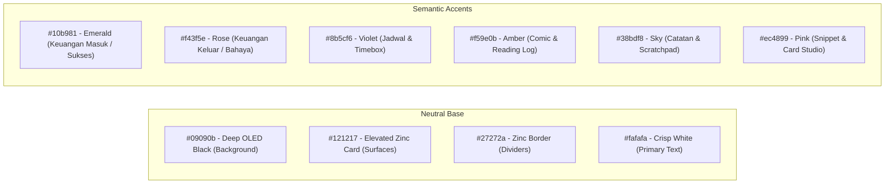

# 🎨 Design System & Token Specification: ShrimpHub
**Style Concept:** OLED Dark Minimalism & Swiss Precision (Inter + JetBrains Mono)  
**Guidelines Source:** UI/UX Pro Max Intelligence (`minimalism-and-swiss-style` + `developer-tool-ide`)  
**Accessibility Target:** WCAG AA (Minimum 4.5:1 Contrast for normal text, 3:1 for large/graphical elements)

---

## 1. Color Palette (Semantic Tokens)

### Contrast Verification Matrix (WCAG Compliance)
| Element | Foreground | Background | Calculated Ratio | WCAG AA Status |
| :--- | :--- | :--- | :--- | :--- |
| **Primary Text** | `#fafafa` | `#09090b` | **18.7 : 1** | PASS (AAA) |
| **Card Body Text** | `#e4e4e7` | `#121217` | **13.2 : 1** | PASS (AAA) |
| **Muted Metadata** | `#a1a1aa` | `#121217` | **6.4 : 1** | PASS (AA) |
| **Emerald Accent** | `#34d399` | `#121217` | **9.1 : 1** | PASS (AAA) |
| **Amber Accent** | `#fbbf24` | `#121217` | **10.8 : 1** | PASS (AAA) |
| **Rose Accent** | `#fb7185` | `#121217` | **7.5 : 1** | PASS (AA) |

---

## 2. Typography Hierarchy

* **Heading & Body Font:** `Inter` (Clean geometric sans-serif)
* **Numbers, Currency, & Code:** `JetBrains Mono` (Monospaced alignment)

| Role | Font Family | Size | Weight | Line Height | Tracking |
| :--- | :--- | :--- | :--- | :--- | :--- |
| **Display / Saldo Utama** | `JetBrains Mono` | 32px / 2rem | 800 (Bold) | 1.1 | `-0.05em` |
| **Section Title (H2)** | `Inter` | 18px / 1.125rem | 700 (Bold) | 1.3 | `-0.02em` |
| **Card Header (H3)** | `Inter` | 14px / 0.875rem | 600 (Semibold) | 1.4 | `-0.01em` |
| **Body Regular** | `Inter` | 14px / 0.875rem | 400 (Regular) | 1.5 | `0` |
| **Caption / Metrik** | `Inter` | 12px / 0.75rem | 500 (Medium) | 1.4 | `0.02em` |
| **KBD / Shortcut Tag** | `JetBrains Mono` | 10px / 0.625rem | 500 (Medium) | 1.0 | `0.05em` |

---

## 3. Micro-Interactions & Motion Physics

Following UI/UX Pro Max Priority 7:
* **Interactive Button Click:** `active:scale-[0.98]` dengan durasi $120\text{ ms}$ (snappy, tactile feel).
* **Hover Transitions:** Durasi $150\text{ ms}$ `ease-out`, opacity glow pada aksen border (`hover:border-emerald-500/40`).
* **Modal Overlay:** Backdrop blur `16px` + opacity transition `150ms`.
* **Zero CLS (Cumulative Layout Shift):** Semua kontainer card memiliki tinggi minimum atau skeleton state terdefinisi ($< 0.1$).

---

## 4. Spacing & Radius System

* **Grid Base Unit:** $4\text{px}$ / $8\text{px}$ increment (`gap-2` = 8px, `gap-4` = 16px, `gap-6` = 24px).
* **Border Radius:**
  - Bento Container: `rounded-2xl` ($16\text{px}$)
  - Buttons & Inputs: `rounded-xl` ($12\text{px}$)
  - Badges & Pills: `rounded-lg` ($8\text{px}$)
  - Shortcut Keycaps: `rounded` ($4\text{px}$)
